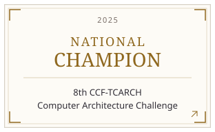
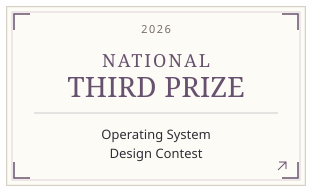
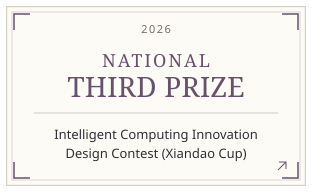
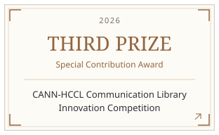
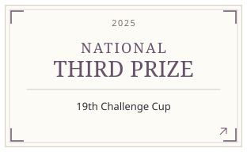
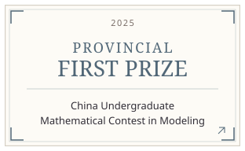

# Competition honors

## CCF-TCARCH 2025

**National Champion**

8th CCF-TCARCH Computer Architecture Challenge · 2025

[Lab award record](https://nbjl.nankai.edu.cn/2023/0716/c13371a604032/page.htm#awards)

[University announcement](https://cc-backend.nankai.edu.cn/news/news-detail/20808)

---

## OS Design 2026

**National Third Prize**

Operating System Design Contest · 2026

[Lab award record](https://nbjl.nankai.edu.cn/2023/0716/c13371a604032/page.htm#awards)

---

## Xiandao Cup 2026

**National Third Prize**

Intelligent Computing Innovation Design Contest (Xiandao Cup) · 2026

[Lab award record](https://nbjl.nankai.edu.cn/2023/0716/c13371a604032/page.htm#awards)

---

## CANN-HCCL 2026

**Third Prize & Special Contribution Award**

CANN-HCCL Communication Library Innovation Competition · 2026

[Lab award record](https://nbjl.nankai.edu.cn/2023/0716/c13371a604032/page.htm#awards)

---

## Challenge Cup 2025

**National Third Prize**

19th Challenge Cup · 2025

[Lab award record](https://nbjl.nankai.edu.cn/2023/0716/c13371a604032/page.htm#awards)

[University award report](https://news.nankai.edu.cn/ywsd/system/2025/11/10/030069539.shtml)

---

## Xiandao Cup 2025

**National Third Prize**

Intelligent Computing Innovation Design Contest (Xiandao Cup) · 2025

[Lab award record](https://nbjl.nankai.edu.cn/2023/0716/c13371a604032/page.htm#awards)

[Competition report](https://www.jiemian.com/article/13643188.html)

---

## CUMCM 2025

**Provincial First Prize**

China Undergraduate Mathematical Contest in Modeling (CUMCM) · 2025

[Lab award record](https://nbjl.nankai.edu.cn/2023/0716/c13371a604032/page.htm#awards)

[Tianjin regional results](https://www.cmathc.org.cn/mcm/news/362.html)

---

## Tianjin Challenge Cup 2025

**Grand Prize**

Tianjin Challenge Cup Undergraduate Extracurricular Academic Science and Technology Works Competition · 2025

[Lab award record](https://nbjl.nankai.edu.cn/2023/0716/c13371a604032/page.htm#awards)

---

## MCM 2025

**Honorable Mention**

Mathematical Contest in Modeling · 2025

[Lab award record](https://nbjl.nankai.edu.cn/2023/0716/c13371a604032/page.htm#awards)

---

## CUMCM 2024

**Provincial Second Prize**

Contemporary Undergraduate Mathematical Contest in Modeling · 2024

[Lab award record](https://nbjl.nankai.edu.cn/2023/0716/c13371a604032/page.htm#awards)

---

## Data Analysis 2024

**National First Prize**

3rd National Undergraduate Data Analysis Popularization Competition · 2024

---
