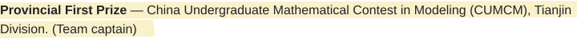
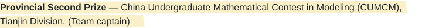

  

## About

I'm a senior undergraduate in Computer Science at **Nankai University**, where I expect to begin my PhD in **2027** with the **[Nankai–Baidu Joint Laboratory (NBJL)](https://nbjl.nankai.edu.cn/)**.

My research interests focus on **LLM inference systems**, **heterogeneous computing and GPU optimization**, and **embodied intelligence system optimization**.

I build tools and share learning resources through **[Lamplighter Commons](https://github.com/lamplighter-commons)**, and contribute to **[StarryOS / tgoskits](https://github.com/rcore-os/tgoskits)**.

> I created **[Triangle Light Maze Solver](https://github.com/lamplighter-commons/triangle-light-maze-solver)**, a solver for triangular-maze problems found in online coding assessments at well-known companies. It uses dynamic programming to compute the path that collects the most lights and displays the result interactively.

Outside computing, I enjoy music (violin and guitar), volleyball, marathon running, and independent travel.

  
  
  
  

## Competition honors

**2026**

- <picture><source media="(max-width: 600px)" srcset="assets/honor-2026-1-compact.svg" /></picture>
- <picture><source media="(max-width: 600px)" srcset="assets/honor-2026-2-compact.svg" /></picture>
- <picture><source media="(max-width: 600px)" srcset="assets/honor-2026-3-compact.svg" /></picture>

**2025**

- <picture><source media="(max-width: 600px)" srcset="assets/honor-2025-4-compact.svg" /></picture>
- **National Third Prize** — Computer System Development Capability Competition — Intelligent Computing Innovation Design Contest (Xiandao Cup).
- <picture><source media="(max-width: 600px)" srcset="assets/honor-2025-5-compact.svg" /></picture>
- **National Third Prize** — 19th Challenge Cup National Undergraduate Extracurricular Academic Science and Technology Works Competition.
- <picture><source media="(max-width: 600px)" srcset="assets/honor-2025-6-compact.svg" /></picture>
- **Grand Prize** — Challenge Cup Tianjin Undergraduate Extracurricular Academic Science and Technology Works Competition.
- <picture><source media="(max-width: 600px)" srcset="assets/honor-2025-7-compact.svg" /></picture>

**2024**

- <picture><source media="(max-width: 600px)" srcset="assets/honor-2024-8-compact.svg" /></picture>
- <picture><source media="(max-width: 600px)" srcset="assets/honor-2024-9-compact.svg" /></picture>

## Contact

For research and collaboration, reach me at **[liangjm@nbjl.nankai.edu.cn](mailto:liangjm@nbjl.nankai.edu.cn)**.

For bugs, questions, or ideas about a project, please open an issue in its repository.

A little planet of my own.

