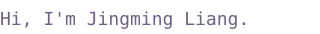

  

  <a href="#about">About</a> &nbsp;·&nbsp; <a href="#competition-honors">Honors</a> &nbsp;·&nbsp; <a href="#contact">Contact</a>

## About

I'm a senior undergraduate in Computer Science at **Nankai University**, where I expect to begin my PhD in **2027** with the **[Nankai–Baidu Joint Laboratory (NBJL)](https://nbjl.nankai.edu.cn/)**.

My research interests focus on **LLM inference systems**, **heterogeneous computing and GPU optimization**, and **embodied intelligence system optimization**.

I build tools and share learning resources through **[Lamplighter Commons](https://github.com/lamplighter-commons)**. I created **[Triangle Light Maze Solver](https://github.com/lamplighter-commons/triangle-light-maze-solver)**, an interactive tool for exploring dynamic programming by finding the path that collects the most lights in a triangular maze. I also contribute to **[StarryOS / tgoskits](https://github.com/rcore-os/tgoskits)**.

Outside computing, I enjoy music (violin and guitar), volleyball, marathon running, and independent travel.

  
  
  
  

## Competition honors

**2026**

- **National Third Prize** — Computer System Development Capability Competition — Operating System Design Contest (OS Function Challenge Track).
- **National Third Prize** — Computer System Development Capability Competition — Intelligent Computing Innovation Design Contest (Xiandao Cup).
- **Third Prize & Special Contribution Award** — CANN-HCCL Communication Library Innovation Competition.

**2025**

- **Second Place** — TRAE Vibe Coding Workshop.
- **National Third Prize** — Computer System Development Capability Competition — Intelligent Computing Innovation Design Contest (Xiandao Cup).
- **Provincial First Prize** — China Undergraduate Mathematical Contest in Modeling (CUMCM), Tianjin Division.
- **National Third Prize** — 19th Challenge Cup National Undergraduate Extracurricular Academic Science and Technology Works Competition.
- **National Champion** — 8th CCF-TCARCH Computer Architecture Challenge.
- **Grand Prize** — Challenge Cup Tianjin Undergraduate Extracurricular Academic Science and Technology Works Competition.
- **Honorable Mention** — Mathematical Contest in Modeling (MCM).

**2024**

- **Provincial Second Prize** — China Undergraduate Mathematical Contest in Modeling (CUMCM), Tianjin Division.
- **National First Prize** — 3rd National College Student Data Analysis Popular Science Competition.

## Contact

For research and collaboration, reach me at **[liangjm@nbjl.nankai.edu.cn](mailto:liangjm@nbjl.nankai.edu.cn)**. More about my background is on my [website](https://www.jingmingliang2004.com/) and [CV](https://www.jingmingliang2004.com/files/jingming-liang-cv.pdf).

For bugs, questions, or ideas about a project, please open an issue in its repository.

---

A little planet of my own.

