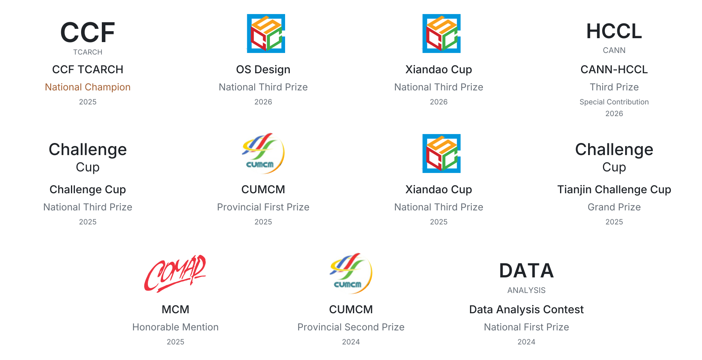

  

  
  
  
  

  I'm <strong>Jingming Liang</strong>, a CS undergraduate at <strong>Nankai University</strong> and incoming PhD student at <a href="https://nbjl.nankai.edu.cn/"><strong>NBJL</strong></a>. My research interests include:

  
  
  

## Competition honors

  <a href="AWARDS.md" title="View the full competition awards record">
    <picture>
      <source media="(max-width: 600px) and (prefers-color-scheme: dark)" srcset="assets/honors-mobile-dark.png" />
      <source media="(max-width: 600px)" srcset="assets/honors-mobile-light.png" />
      <source media="(prefers-color-scheme: dark)" srcset="assets/honors-dark.png" />
      
    </picture>
  </a>

[Full awards record](AWARDS.md)

## Open-source contributions

Contributor to **[StarryOS / tgoskits](https://github.com/rcore-os/tgoskits)** — [merged PRs](https://github.com/rcore-os/tgoskits/pulls?q=is%3Apr+is%3Amerged+author%3Aeprogressing).

---

Music, marathon running, independent travel — and a little planet of my own.
